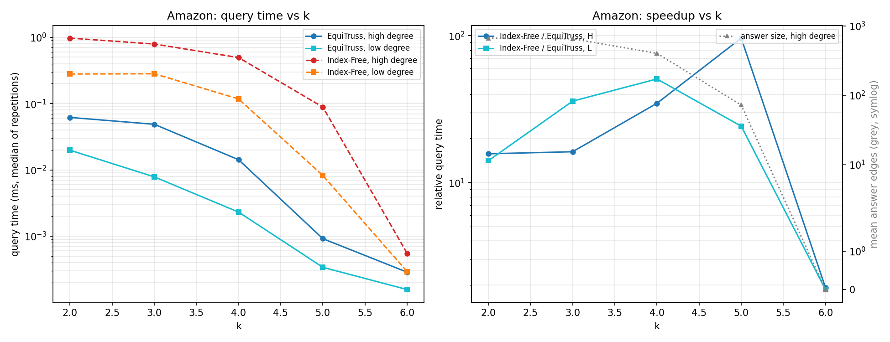
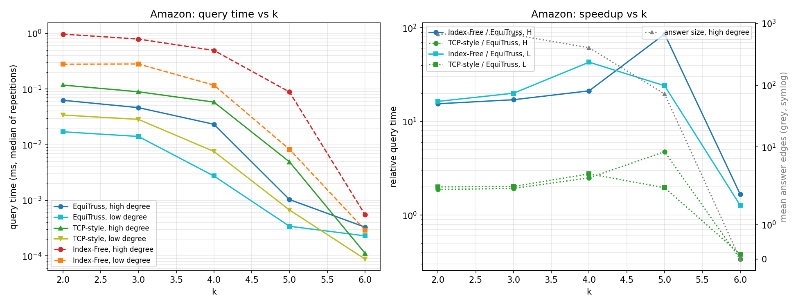
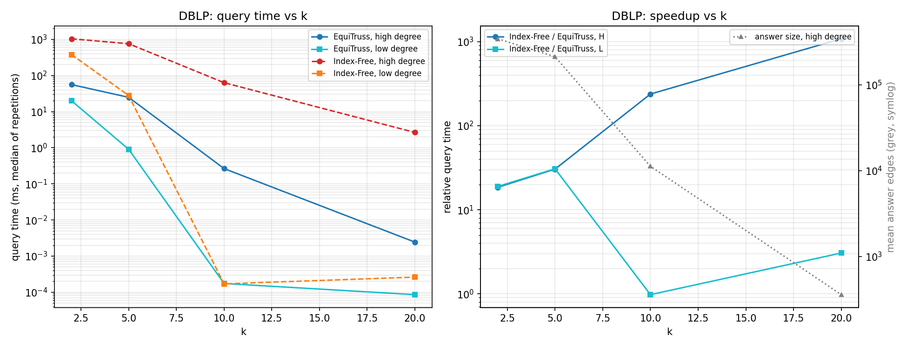
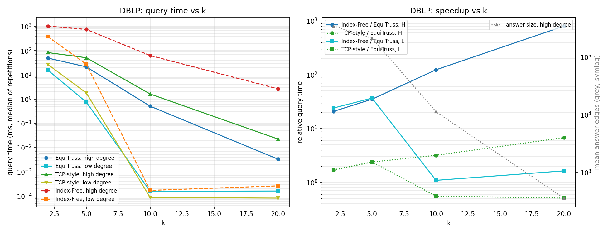
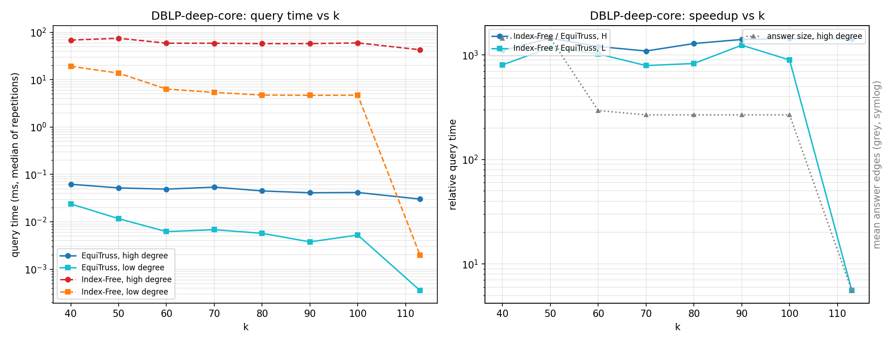
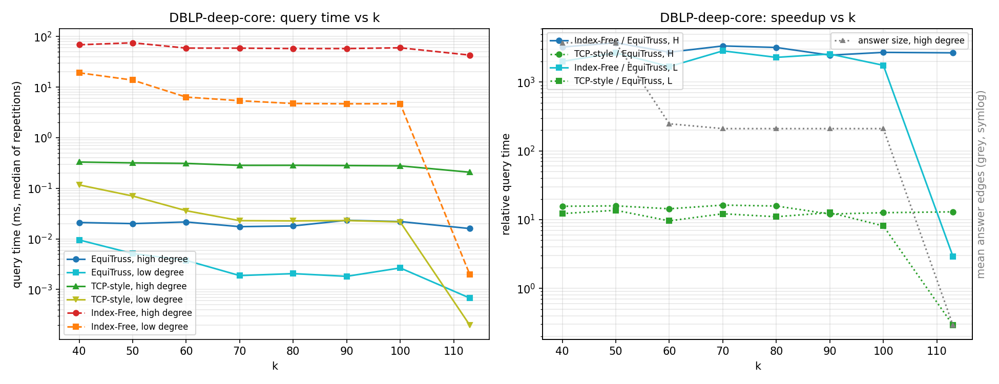

# k-Core on the EquiTruss Index

## Purpose

This work tests whether the EquiTruss framework can use k-core-derived edge levels without redesigning its core structure.

## Edge weights

Let `c(v)` be the core number of vertex `v`. Each edge `(u,v)` receives:

```text
w(u,v) = min(c(u), c(v))
E_k    = {e : w(e) >= k}
```

`E_k` is exactly the edge set induced by vertices whose core number is at least `k`.

```text
graph -> core decomposition -> edge weights -> existing index -> queries
```

## Community definition

The EquiTruss triangle-connectivity rule is retained. A query returns every **triangle-connected component of the k-core** that contains the query vertex.

One query may return several communities. Two regions remain separate if their edges are not connected by a sequence of qualifying triangles, even when they belong to the same connected k-core. Communities may overlap on vertices.

For core-derived weights, the index's triangle shortcut is safe:

```text
w(x,y) >= k and w(x,z) >= k
=> c(x), c(y), c(z) >= k
=> w(y,z) >= k
```

## Implementation

`CoreDecomposition.java` computes core numbers using bucket-based peeling in `O(|V| + |E|)` time. It assigns each graph edge the minimum core number of its endpoints and passes the resulting level map to the existing index:

```text
CoreDecomposition.coreNumbers(graph)
CoreDecomposition.coreWeights(graph, coreNumbers)
MyGraph.createKedgeList(weights)
TecIndexSB.constructIndex(levels, weights, graph)
```

The EquiTruss index and query traversal were not redesigned. Level 2 is retained because it is meaningful for k-core, and console output is disabled during timing.

### TCP-style comparison index

A TCP-style index was independently implemented from Algorithms 3 and 4 of Huang et al. It is not copied from an external repository and is not the original authors' source code.

For each vertex `x`, every triangle `(x,y,z)` creates a local connection with level:

```text
min(w(x,y), w(x,z), w(y,z))
```

A maximum spanning forest preserves local triangle connectivity at every threshold. Query processing follows forest connections and reverses each discovered edge to continue from its other endpoint. `TcpIndex.java` uses the same core weights and returns the same triangle-connected k-core communities as EquiTruss and Index-Free.

## Experimental Results

### Setup

Experiments ran on an Apple M3 Pro with 18 GB RAM, macOS, and JDK 27. The JVM used equal `-Xms` and `-Xmx` values.

| Graph | Vertices | Edges | Max core | Max truss | Fixed k |
|---|---:|---:|---:|---:|---:|
| ca-GrQc | 5,241 | 14,484 | 43 | 44 | 5 |
| com-Amazon | 334,863 | 925,872 | 6 | 7 | 4 |
| com-DBLP | 317,080 | 1,049,866 | 113 | 114 | 5 |

The query protocol follows the EquiTruss paper:

- **Fixed k:** ten degree groups, 100 sampled vertices per group, 1,000 queries per graph.
- **Different k:** 100 high-degree vertices (`H`, top 30%) and 100 low-degree vertices (`L`, remaining 70%). The same vertices are reused at every `k`.
- **Deep core:** 20 targeted DBLP vertices per set with core number at least 40; this is a separate stress test, not a representative random sample.

Construction values are medians of three runs. Different-`k` query values are medians of five repetitions of mean query time.

### 1. k-core compared with k-truss

Both rows use the EquiTruss structure; only the decomposition-derived edge levels change.

| Graph | Metric | Decomposition (s) | Index construction (s) | Total (s) | Estimated index (MB) | Super-nodes | Super-edges | Compression, level >= 3 |
|---|---|---:|---:|---:|---:|---:|---:|---:|
| GrQc | k-truss | 0.1370 | 0.0537 | 0.1907 | 0.1410 | 1,569 | 889 | 8.21 |
| GrQc | k-core | **0.0458** | **0.0276** | **0.0735** | 0.2084 | 3,387 | 1,075 | 8.08 |
| Amazon | k-truss | 6.1273 | **1.5398** | 7.7114 | **9.72** | 115,060 | 103,513 | 6.21 |
| Amazon | k-core | **2.7846** | 1.7299 | **4.5540** | 15.55 | 297,882 | 60,021 | 3.97 |
| DBLP | k-truss | 9.1284 | **2.2034** | 11.3280 | **11.15** | 126,904 | 105,409 | 7.70 |
| DBLP | k-core | **2.6066** | 3.0944 | **5.7766** | 15.13 | 232,067 | 150,130 | 6.58 |

**Result:** k-core decomposition is 2.2x–3.5x faster, and total k-core preparation is 1.7x–2.6x faster. The raw k-core index is 1.36x–1.60x larger because meaningful levels 1 and 2 are also indexed. At level 3 and above, the GrQc compression difference almost disappears; Amazon and DBLP retain some additional fragmentation.

### 2. EquiTruss compared with TCP-style index construction

Both indexes use the same k-core weights. Sizes are logical estimates from stored IDs and links, not total JVM heap usage.

| Graph | TCP construction (s) | EquiTruss construction (s) | TCP / Equi time | TCP size (MB) | EquiTruss size (MB) | TCP forest edges | EquiTruss super-nodes |
|---|---:|---:|---:|---:|---:|---:|---:|
| GrQc | 0.0744 | **0.0499** | 1.49x | 0.745 | **0.319** | 20,847 | 3,387 |
| Amazon | 2.8225 | **2.2849** | 1.24x | 44.56 | **22.61** | 1,132,526 | 297,882 |
| DBLP | 4.1985 | **2.9602** | 1.42x | 54.68 | **23.14** | 1,587,483 | 232,067 |

**Result:** EquiTruss is 1.2x–1.5x faster to construct and its estimated compact index is 1.97x–2.36x smaller than the TCP-style adaptation. Each method was measured in a separate fresh JVM, and EquiTruss timing includes level bucketing.

### 3. Fixed-k query comparison

All methods use the same core weights and community definition. The TCP/EquiTruss values are means of per-query medians across five repetitions with alternating execution order. Index-Free was measured in a separate JVM using the identical query files to avoid index-memory and garbage-collection interference.

#### Without TCP

| Graph | k | Queries | EquiTruss mean (ms) | Index-Free mean (ms) | Free / Equi |
|---|---:|---:|---:|---:|---:|
| GrQc | 5 | 1,000 | 0.006743 | 0.707056 | **104.9x** |
| Amazon | 4 | 1,000 | 0.027940 | 0.332329 | **11.9x** |
| DBLP | 5 | 1,000 | 9.345904 | 262.824302 | **28.1x** |

#### With TCP

| Graph | EquiTruss mean (ms) | TCP-style mean (ms) | Index-Free mean (ms) | TCP / Equi | Free / TCP |
|---|---:|---:|---:|---:|---:|
| GrQc | **0.010145** | 0.018571 | 0.707056 | 1.83x | 38.07x |
| Amazon | **0.025117** | 0.047062 | 0.332329 | 1.87x | 7.06x |
| DBLP | **7.574697** | 17.901210 | 262.824302 | 2.36x | 14.68x |

**Result:** TCP-style is much faster than Index-Free, but EquiTruss is another 1.8x–2.4x faster than TCP-style. The EquiTruss values differ from the TCP-free table because that earlier table uses one timed pass, while this table uses five balanced repetitions; ratios should be interpreted within each table.

`Mean answer edges` is the total number of edges across all communities returned by one query. Zero-result queries contribute zero.

| Graph | Non-empty queries | Queries returning multiple communities | Mean edges, all queries | Mean edges, non-empty only |
|---|---:|---:|---:|---:|
| GrQc | 179 | 39 | 328 | 1,831 |
| Amazon | 511 | 220 | 292 | 571 |
| DBLP | 321 | 95 | 80,515 | 250,826 |

DBLP takes longer because its returned communities are much larger. One query can return multiple triangle-connected communities, as shown by the third column.

### 4. Different-k query comparison

The compact table shows selected high-degree (`H`) results. Complete H/L values are in the CSVs and figures.

| Graph | k | Mean answer edges | EquiTruss (ms) | TCP-style (ms) | Index-Free (ms) | TCP / Equi | Free / Equi |
|---|---:|---:|---:|---:|---:|---:|---:|
| Amazon | 2 | 668 | 0.062772 | 0.117865 | 0.970665 | 1.9x | 15.5x |
| Amazon | 4 | 402 | 0.023268 | 0.058182 | 0.494066 | 2.5x | 21.2x |
| Amazon | 5 | 72 | 0.001033 | 0.004912 | 0.088525 | 4.8x | 85.7x |
| DBLP | 2 | 343,465 | 49.706574 | 83.750290 | 1037.940763 | 1.7x | 20.9x |
| DBLP | 5 | 212,294 | 21.554670 | 51.382229 | 757.494877 | 2.4x | 35.1x |
| DBLP | 10 | 11,242 | 0.510424 | 1.625514 | 63.173618 | 3.2x | 123.8x |
| DBLP | 20 | 360 | 0.003307 | 0.022392 | 2.653127 | 6.8x | 802.3x |

**Result:** as `k` increases, answer size usually decreases. EquiTruss gains more over TCP-style and Index-Free when the answer is small but non-empty. Empty-result cells are retained in the figures but their speedup ratios are not interpreted.

#### Amazon — without and with TCP





#### DBLP — without and with TCP





### 5. DBLP deep-core comparison

| k | Mean answer edges | EquiTruss (ms) | TCP-style (ms) | Index-Free (ms) | TCP / Equi | Free / Equi |
|---:|---:|---:|---:|---:|---:|---:|
| 40 | 6,886 | 0.021131 | 0.330456 | 68.564971 | 15.6x | 3,244.8x |
| 60 | 6,098 | 0.021623 | 0.310873 | 58.946058 | 14.4x | 2,726.1x |
| 90 | 6,054 | 0.023356 | 0.281660 | 57.710533 | 12.1x | 2,470.9x |
| 113 | 4,508 | 0.016035 | 0.208069 | 42.866496 | 13.0x | 2,673.3x |

This targeted experiment shows the best high-`k` regime and is not representative random-query performance.





## Experiments not completed

| Paper experiment or dataset | Reason |
|---|---|
| LiveJournal, Orkut, UK-2002 | The current object-heavy Java graph representation exceeds the available 18 GB RAM. A larger-memory machine or compact representation is required. |
| Dynamic edge insertion/deletion | The k-core adaptation has no incremental core-number and index-maintenance implementation. Rebuilding from scratch would not reproduce the paper's dynamic algorithm. |
| Named DBLP case study | The SNAP graph provides numeric IDs but no matching author-name map. The paper authors' mapping or a newly generated DBLP graph is required. |
| Original TCP-Index binary/source | No author-issued public implementation was found. The TCP-style baseline here is an independent implementation of the published algorithms. |

## Result files

- TCP-free fixed queries: `results/{grqc_bench,amazon_bench,dblp_bench_100}/bench.csv`
- TCP/Equi fixed queries: `results/{grqc,amazon,dblp}_tcp_bench/bench.csv`
- Combined query files and plots: `results/*_combined/`
- Isolated construction runs: `results/{grqc,amazon,dblp}_index_compare/index_compare.csv`
- Aggregate tables: `results/summary/`

## References

1. E. Akbas and P. Zhao. “Truss-Based Community Search: A Truss-Equivalence Based Indexing Approach.” PVLDB 10(11), 1298–1309, 2017. https://doi.org/10.14778/3137628.3137640
2. X. Huang, H. Cheng, L. Qin, W. Tian, and J. X. Yu. “Querying K-Truss Community in Large and Dynamic Graphs.” SIGMOD, 2014. https://doi.org/10.1145/2588555.2610495
3. V. Batagelj and M. Zaversnik. “An O(m) Algorithm for Cores Decomposition of Networks.” arXiv:cs/0310049, 2003.
4. J. Cheng, Y. Ke, S. Chu, and M. T. Özsu. “Efficient Core Decomposition in Massive Networks.” ICDE, 2011.
